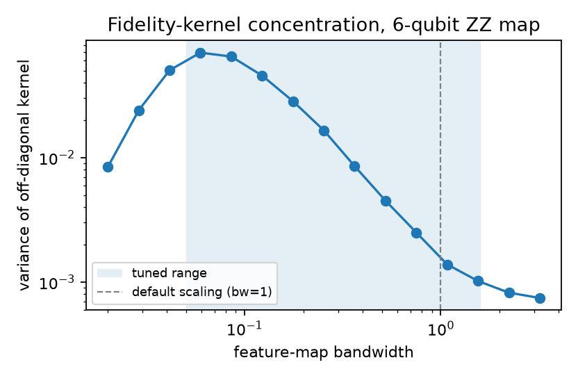
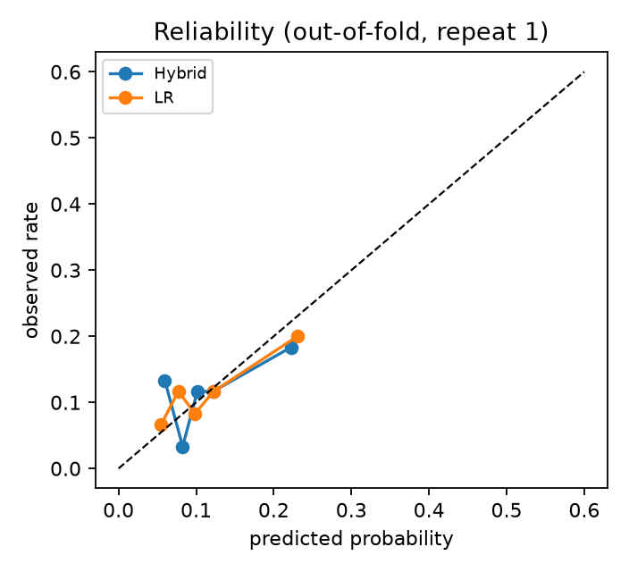
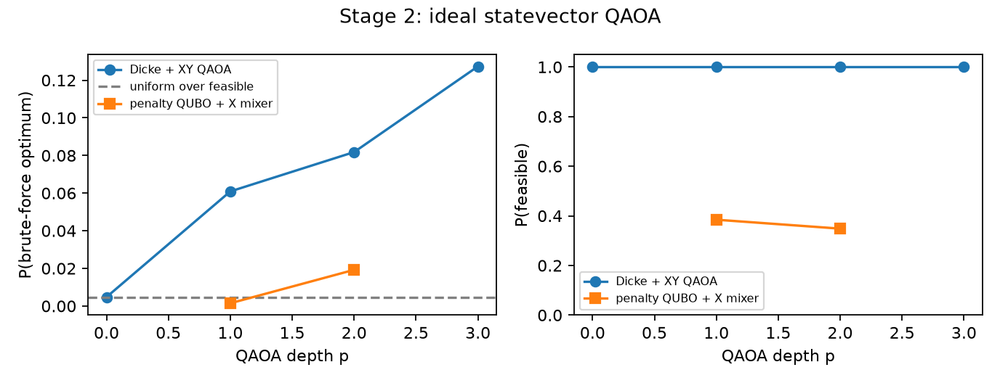
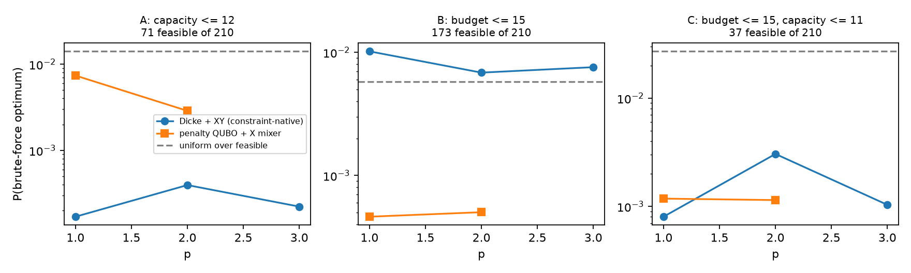
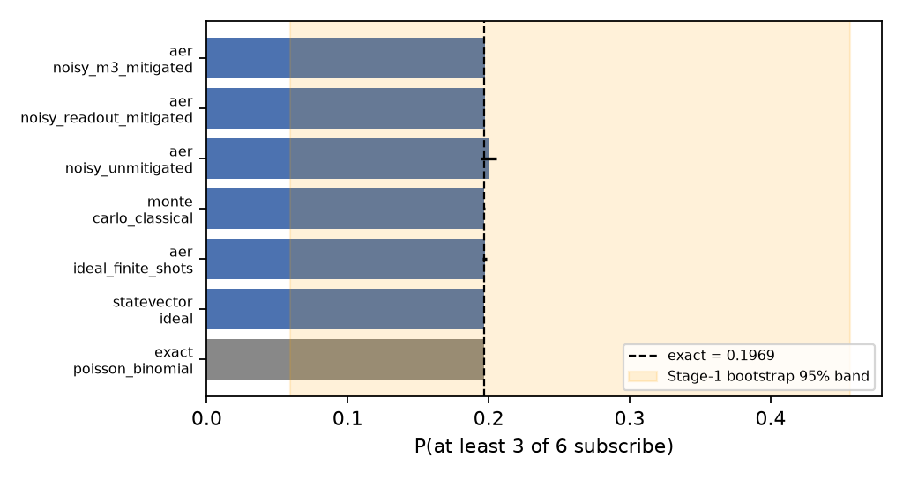
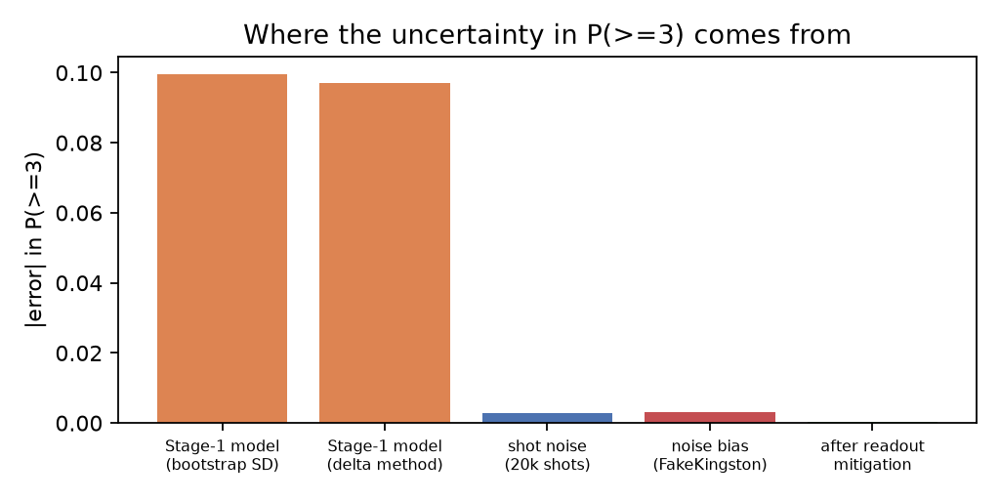

# Six customers, one campaign

A bank's campaign team can afford six calls for a term-deposit offer. This pipeline tells them which six customers to call and how likely the campaign is to reach three sign-ups. It is built on Qiskit and IBM Quantum tooling for The Atomiq Hackathon (Qiskit Fall Fest 2026 at IEM). Every quantum number in it is checked against an exact classical answer.

## The problem

Most people a bank calls about a term deposit say no. In the organisers' release, 46 of the 400 sampled customers subscribed (11.5%), and only 35 of the 300 labelled training customers did. The organisers' data sheet gives these counts. The customers come from the UCI Bank Marketing data (`bank.csv`), records of a Portuguese bank's phone campaigns (Moro, Cortez & Rita, *Decision Support Systems* 62, 2014). Calling everyone wastes money, and calling only the most likely customers ignores what each call costs and what each deposit is worth. The task gives each candidate a contact cost, an expected deposit and a capacity load, with limits of 25 and 22 for a call list of exactly six.

So the team needs three answers:
1. Who is likely to subscribe?
2. Which six give the best expected value within the limits?
3. How likely is it that at least three of those six subscribe?

## The answer we submit

| | Value | Where it comes from |
|---|---|---|
| Customers to contact (Stage 2) | **C0031, C0081, C0079, C0087, C0397, C0374** | `stage2_selection.json` |
| P(at least 3 of 6 subscribe), quantum estimate (Stage 3) | **0.1971** ± 0.0009 (1 s.e., 200,000 shots) | `stage3_simulation.json` |
| Exact value from the same probabilities | 0.1969 | Poisson-binomial |
| Stage 2 optimality gap vs brute force | **0.0%** (18.297 vs 18.297) | all 210 subsets checked |
| Budget / capacity used | 13 of 25 / 10 of 22 | |
| Uncertainty carried in from Stage 1 | 95% bootstrap band 0.059 to 0.456 | 200 refits on resampled training data |

The last row matters most for the business reading. About one campaign in five reaches three sign-ups, and that estimate is only as good as a classifier trained on 35 positive examples. The quantum sampling error is about 110 times smaller than that model error.

## Proof it runs

We have no real users: this is a hackathon task scored on hidden labels, and we did not put the list in front of a bank. What we can show is that anyone can check the result without trusting us:

- **Live page, no login.** https://yasaswip012.github.io/atomiq-quantum-campaign/ shows the answer. It lets you pick any six customers and compare them with brute force, and it samples the Stage 3 distribution in your browser.
- **CI on a different operating system.** Every push reruns all three stages from scratch on Ubuntu. CI then checks that the ranking, the top 10 and the six customers match the committed files, with probabilities equal to within 1e-15. ([latest runs](https://github.com/YASASWIP012/atomiq-quantum-campaign/actions/workflows/ci.yml))
- **One command.** `make setup && make all` rebuilds every result file, runs 26 tests and a 25-point cross-stage check.

## Links

| What | Where |
|---|---|
| **Judges' page (no login): answer, live Stage 2 checker, Stage 3 sampler** | https://yasaswip012.github.io/atomiq-quantum-campaign/ |
| CI (tests + full rerun on every push) | [](https://github.com/YASASWIP012/atomiq-quantum-campaign/actions/workflows/ci.yml) |
| Slide deck (PDF, built from the result files) | [`presentation/deck.pdf`](presentation/deck.pdf) |
| Video walkthrough (1 min 57 s) | [Google Drive](https://drive.google.com/file/d/1gyAnmR2OFbqoD_Thv0iyW7rwI3YuVDzm/view?usp=sharing) · same file in the repo: [`presentation/walkthrough.mp4`](presentation/walkthrough.mp4) (rebuilt from the result files by `scripts/make_video.py`) |
| Result files | [`stage1_predictions.csv`](stage1_predictions.csv), [`stage2_selection.csv`](stage2_selection.csv) / [`.json`](stage2_selection.json), [`stage3_simulation.csv`](stage3_simulation.csv) / [`.json`](stage3_simulation.json) |
| Notebook (runs the modules, shows every result, runs the 25 checks) | [`notebooks/end_to_end.ipynb`](notebooks/end_to_end.ipynb) |
| Pre-registered model-selection rule (committed before any fit) | [`PREREGISTRATION.md`](PREREGISTRATION.md) |
| Submission self-check (25 checks) | `make check` → [`scripts/check_submission.py`](scripts/check_submission.py) |

## Why IBM Quantum and Qiskit

The task requires a quantum or hybrid method at each stage. Here is what the IBM stack does in ours.

- **Stage 2 needs gate-level circuits that compile for IBM hardware.** We prepare the Dicke state from CX, CRY and CCRY gates, not `initialize`, and mix with Qiskit's `XXPlusYYGate`. That way the "exactly six customers" rule holds on every shot, and the same circuit transpiles to a Heron processor's heavy-hex layout. We report its real cost there: 663 two-qubit gates and 119 SWAPs at depth 3.
- **Noise comes from IBM calibration data.** Noisy runs use `AerSimulator.from_backend(FakeKingston)`, a calibration snapshot of IBM's 156-qubit Heron r2. Readout mitigation is checked against IBM's `mthree`.
- **The hardware path is ready.** `scripts/run_hardware.py` uses `qiskit-ibm-runtime` to send one job to `ibm_kingston` on the free Open Plan. We did not run it (see limits).

None of this is a quantum advantage. Each problem here is small enough to solve exactly on a laptop, and we solve it exactly every time to check the quantum result.

| Stage | Quantum part | Classical part | Verified against |
|---|---|---|---|
| 1 | ZZ feature-map states on 6 qubits, used as a fidelity kernel and a projected (single-qubit Pauli) kernel | preprocessing, PCA to 6 angles, SVM, Platt calibration, the blend weight, logistic regression | classical baselines in the same nested CV |
| 2 | Dicke-state preparation, cost-phase layers, XY ring mixer, sampling | COBYLA parameter search, presolve, decoding | brute force over all 210 subsets |
| 3 | 6-qubit RY product state, measurement | counting outcomes with ≥ 3 ones | exact Poisson-binomial and 10⁶-draw Monte Carlo |

## How it works

```
Stage1_Train (300, 35 yes) ──► nested CV ──► hybrid model ──► p_i for 100 test customers ──► top 10
                                   (train only)   0.9·LR + 0.1·quantum kernel               │
                                                                                            ▼
          brute force (210 subsets) ◄── check ── Stage 2: Dicke(10,6) + XY-ring QAOA ──► 6 IDs
                                                                                            │
          exact Poisson-binomial, Monte Carlo ◄── check ── Stage 3: 6 RY qubits ──► P(≥3)  ▼
                                    Stage 1 bootstrap ──► uncertainty carried through Stages 2 and 3
```

Stage 1 probabilities flow unchanged into Stages 2 and 3. `scripts/check_submission.py` recomputes the Stage 2 objective and the Stage 3 exact value from `stage1_predictions.csv` and fails if anything drifts.

- **Stage 1** turns each customer into six angles and encodes them in a 6-qubit ZZ feature map. The resulting quantum kernels are blended with logistic regression under a rule committed before any model was fitted.
- **Stage 2** runs QAOA from a Dicke state with an XY ring mixer, so only valid six-customer picks can come out. It is checked against all 210 subsets.
- **Stage 3** rotates one qubit per chosen customer to that customer's probability, counts shots with at least three ones, and compares the result with the exact Poisson-binomial value.

## Evidence, stage by stage

### Stage 1: subscription prediction

**Data handling.** All preprocessing is fitted inside each training fold: a signed log transform for balance, logs of campaign, pdays and previous, a "contacted before" flag, a "previous campaign succeeded" flag, and standardised one-hot encoding of month, poutcome, contact, housing and loan. The test set is predicted once, at the end. The `duration` column is not in the release, which avoids the well-known leak in this dataset.

**Quantum models.** Each customer becomes 6 angles (PCA fitted on the training fold, then standardised) times a bandwidth factor, encoded with the linear-entanglement `zz_feature_map(6, reps=2)`.

- *Fidelity kernel (QK):* k(x, x') = |⟨φ(x)|φ(x')⟩|².
- *Projected kernel (PQK):* an RBF kernel on the 18 single-qubit expectations ⟨X⟩, ⟨Y⟩, ⟨Z⟩ of each state (Huang et al., 2021).
- PCA components are only defined up to sign, and the ZZ map is not sign-symmetric, so each component is oriented to give the training projections positive skew. Without this, macOS and Linux produced different kernels (see the changes list below).
- Both feed a class-balanced SVM, then Platt scaling fitted on out-of-fold decision values.
- Statevectors are computed exactly with a vectorised simulator. `tests/test_kernels.py` checks it against `qiskit.quantum_info.Statevector` on Qiskit's own `zz_feature_map` circuit, to 1e-10.

**Why bandwidth matters.** At the default scaling, fidelity kernels between different customers bunch close to a constant ("exponential concentration"), and the SVM has little to learn from. We tune the bandwidth inside the inner CV loop (Shaydulin & Wild, *Importance of kernel bandwidth in quantum machine learning*, arXiv:2111.05451).



Off-diagonal kernel variance peaks near bandwidth 0.06. At bandwidth 1 it is about 40 times smaller.

**Model selection.** We ran 10 × repeated stratified 5-fold CV on the 300 training customers, with an inner 3-fold loop for every hyperparameter: LR strength, kernel bandwidth, kernel type, SVM C, and the blend weight w. The table gives the mean over 50 outer folds, with precision and recall at k = 10% of the fold.

| Model | ROC-AUC | PR-AUC | Brier | Log loss | Precision@k | Recall@k |
|---|---|---|---|---|---|---|
| Constant prior | 0.500 | 0.117 | 0.1031 | 0.360 | 0.177 | 0.151 |
| Logistic regression | **0.651** | **0.332** | **0.0965** | **0.340** | **0.277** | **0.237** |
| Gradient boosting | 0.542 | 0.258 | 0.1098 | 0.410 | 0.250 | 0.214 |
| Quantum fidelity kernel (QK) | 0.510 | 0.227 | 0.1033 | 0.363 | 0.180 | 0.154 |
| Projected quantum kernel (PQK) | 0.497 | 0.184 | 0.1046 | 0.369 | 0.147 | 0.126 |
| **Hybrid (shipped procedure)** | 0.649 | 0.330 | 0.0976 | 0.344 | **0.277** | **0.237** |

The pre-registered rule is a non-inferiority test with no margin. It ships the hybrid when its log loss is no worse than LR's (paired 95% CI contains 0) and its PR-AUC is not clearly worse (CI upper bound ≥ 0). With 35 positives these intervals are wide, so the rule is lenient, and we say so. We used corrected resampled t intervals (Nadeau & Bengio, 2003). The hybrid's log-loss difference from LR is +0.003 [−0.007, +0.013], and its PR-AUC difference is −0.002 [−0.014, +0.010]. Both conditions hold, so the shipped model is the hybrid, refitted on all 300 customers. On the full training set the inner loop chose the projected kernel (bandwidth 0.1, γ = 0.1, C = 0.1) and a blend of **0.9 · LR + 0.1 · PQK**. Inside the CV the blend weight on the quantum model was 0 in 30 of 50 folds, 0.1 to 0.3 in 14 and 0.4 or more in 6, so 0.1 is typical for the procedure.

What this shows, stated plainly: on 300 rows with 35 positives, the quantum kernels on their own rank customers about as well as chance, and the blend is not distinguishable from logistic regression. Logistic regression is the strongest single model here. We report this as a negative result for the quantum classifier. The quantum component is in the shipped model, with a small weight, because the rule we fixed in advance allows it.

**What plain LR would have done.** We also refitted LR alone on all 300 customers (`results/stage1_predictions_LR_only.csv`). Its ranking has a Spearman correlation of 0.999 with ours. It has the same top 10, and brute force on it picks the same six customers. Under LR's probabilities, P(≥3) for those six would be 0.222 instead of 0.197. So the quantum blend shifts the probabilities slightly and does not change the decision.

**Changes made after the first run, and why.** The decision rule in `PREREGISTRATION.md` was committed before any model was fitted (see `git log`). After that commit we made four changes, all on training data only, and kept each earlier table in `results/`. The reported LR numbers are therefore somewhat optimistic, because features were chosen on the same CV.

1. Dropping job, marital, education and default lifted LR's CV ROC-AUC from 0.605 to 0.621. The first-run table is `stage1_cv_summary_ablation_allcats.csv`.
2. The first run used unregularised Platt scaling (C = 1e4). On inner folds with about four positives it became overconfident, and the quantum models' log loss reached 0.55 ± 0.84. Regularising it (C = 1) brought that to 0.367 ± 0.024. That table is `stage1_cv_summary_ablation_unregularised_platt.csv`. The decision rule did not change.
3. Our CI reruns everything on Linux. The first such run produced a different top 10 from macOS: Linux LAPACK returned one PCA component with the opposite sign, and the ZZ feature map is not sign-symmetric, so the kernel changed. We now fix each component's sign by the skew of its training projections (a first attempt, "largest loading positive", still tied on one-hot pairs with exactly opposite loadings). We also round tuning scores to 6 decimals so exact ties break the same way everywhere. This fix changed our own answer: before it, the final blend was 0.7 · LR + 0.3 · PQK and the six were C0031, C0256, C0028, C0338, C0079 and C0088. We kept the new result because it is what the committed procedure produces once it is platform-independent.
4. A blind review pointed out that the three test customers whose previous campaign succeeded got low probabilities (0.13 to 0.17), although that group subscribed 6 times out of 10 in training. Two things caused it. `poutcome = success` covers only 10 training rows, so L2 regularisation shrank its one-hot column toward zero. And the final blend at that time put weight 0.8 on a near-chance kernel. We added a "previous campaign succeeded" flag and standardised the one-hot columns, comparing variants on training-only CV. LR's CV PR-AUC rose from 0.269 to 0.332 and its Brier score improved from 0.1016 to 0.0965. The table before this change is `results/stage1_cv_summary_ablation_no_success_flag.csv`. The decision rule was not changed. This change also changed our six customers, from C0028, C0229, C0183, C0170, C0007, C0031 to the list at the top.



### Stage 2: choosing six customers

**Problem.** Maximise Σᵢ (pᵢ · depositᵢ − costᵢ) xᵢ over the top 10, subject to Σ xᵢ = 6, Σ costᵢ xᵢ ≤ 25 and Σ capacityᵢ xᵢ ≤ 22.

**Presolve: neither inequality can bind for our candidates.** The six most expensive candidates cost 18 in total, which is within the budget of 25. The six largest capacities add up to 18, which is within 22. So every subset of size six is feasible, and the budget and capacity constraints need no slack qubits and no penalty terms. The solver checks this in `presolve()`. If a different top 10 made either constraint binding, the code adds a bounded slack register and an equality penalty λ(capacity·x + s − 22)², where λ = 1 + Σ|vᵢ|/max|vᵢ| is larger than the whole objective range.

**Cardinality by construction.** We do not add a (Σx − 6)² penalty. The circuit starts in the Dicke state |D⁶₁₀⟩, an equal superposition of all 210 strings with six ones. It is prepared deterministically from CX, CRY and CCRY gates (Bärtschi & Eidenbenz 2019, arXiv:1904.07358), not with `initialize`, so it compiles for hardware. The mixer is exp(−iβ(XX + YY)/2) applied to the edges of a 10-qubit ring in two parity layers, and it preserves Hamming weight. Every sample therefore has exactly six ones. Tests check that the Dicke state is uniform over weight 6, that the mixer conserves weight, and that the RZ/RZZ phase separator matches the QUBO diagonal.

**Cost Hamiltonian.** With vᵢ = pᵢDᵢ − cᵢ scaled by max|v|, the cost is f(x) = −Σ vᵢxᵢ. Substituting xᵢ = (1 − zᵢ)/2 gives hᵢ = vᵢ/2 with no ZZ terms. The phase layer is then one RZ(2γhᵢ) per qubit. The Ising coefficients are in `stage2_selection.json` → `formulation`.

**Optimisation.** We used COBYLA with 4 random starts per depth and INTERP warm starts from depth p to p + 1 (Zhou et al., 2020). Seeds are in `src/atomiq/common.py`.

| Ansatz (ideal statevector) | p | P(feasible) | P(brute-force optimum) | Approx. ratio* |
|---|---|---|---|---|
| Dicke state only (uniform guess) | 0 | 1.000 | 0.0048 (= 1/210) | 0.671 |
| Dicke + XY ring QAOA | 1 | 1.000 | 0.0609 | 0.846 |
| Dicke + XY ring QAOA | 2 | 1.000 | 0.0818 | 0.854 |
| **Dicke + XY ring QAOA** | **3** | **1.000** | **0.1273** | **0.880** |
| Penalty QUBO + X mixer (common baseline) | 1 | 0.384 | 0.0015 | 0.540 |
| Penalty QUBO + X mixer | 2 | 0.348 | 0.0192 | 0.835 |



\*Approx. ratio is the expected objective of feasible samples divided by the optimum. One candidate has a negative net value, so the ratio is not shift-invariant. Read it as a relative comparison only.

At p = 3 the circuit returns the optimum 27 times more often than uniform guessing. The usual penalty formulation wastes more than half its shots on invalid strings. We sampled 4,096 shots (seed 5). The pre-registered rule takes the highest-objective feasible string among the samples. Here that is `1010010111` (520 shots), which decodes to the brute-force optimum.

**Decoding and bit order.** Qubit i is the i-th ranked candidate. Qiskit count keys are written with qubit 0 on the right, so `1010010111` reversed is 1,1,1,0,1,0,0,1,0,1. That gives qubits 0, 1, 2, 4, 7 and 9, which are C0031, C0081, C0079, C0087, C0397 and C0374. `tests/test_qaoa.py::test_bit_ordering_round_trip` pins this down.

**Close call.** The runner-up subset scores 17.639, which is 3.6% below the optimum. A model with slightly different probabilities can swap one customer, as the bootstrap below shows.

#### Stress test: what happens when the constraints bind

On the real limits the cost layer has no ZZ terms, so the penalty and slack machinery never runs. To test it we kept the same ten candidates and tightened the limits until they bind (`python -m atomiq.stage2_stress`, results in `results/stage2_stress.json`). Each slack register is a bounded binary encoding of 0 to (limit − smallest 6-subset total), and a test checks that it covers exactly that range. The optimiser runs on an exact vectorised simulator that tests show matches Qiskit's statevector for both mixers.

| Scenario | Feasible subsets | Qubits (slack) | ZZ terms | Ansatz | P(feasible) p=1 / 2 / 3 | P(optimum) p=1 / 2 / 3 | Best sample = optimum? |
|---|---|---|---|---|---|---|---|
| A: capacity ≤ 12 | 71 | 12 (2) | 66 | Dicke + XY | 0.308 / 0.271 / 0.329 | 0.0002 / 0.0004 / 0.0002 | p = 2 and 3 only |
| | | | | penalty + X | 0.109 / 0.082 / – | 0.007 / 0.003 / – | yes |
| B: budget ≤ 15 | 173 | 13 (3) | 78 | Dicke + XY | 0.904 / 0.910 / 0.916 | 0.010 / 0.007 / 0.008 | yes, all depths |
| | | | | penalty + X | 0.178 / 0.222 / – | 0.0005 / 0.0005 / – | p = 1 only |
| C: budget ≤ 15, capacity ≤ 11 | 37 | 15 (5) | 99 | Dicke + XY | 0.454 / 0.460 / 0.458 | 0.001 / 0.003 / 0.001 | yes, all depths |
| | | | | penalty + X | 0.042 / 0.046 / – | 0.001 / 0.001 / – | yes |



What we take from this:

- Keeping the search inside the six-of-ten subspace leaves 3 to 10 times more probability on feasible strings than the standard penalty QUBO (at p = 2).
- With 4,096 shots, the best feasible sample is the brute-force optimum in 13 of 15 runs. With at most 210 candidate subsets that is a weak test, so we also report P(optimum).
- P(optimum) is often below what you would get by sampling uniformly from the feasible set (1/71, 1/173 and 1/37 here). Only scenario B beats it, at every depth; A and C fall below it, and in A the penalty QUBO does better. COBYLA minimises the expected penalised cost, not P(optimum), and with large penalty terms those two objectives come apart. You would also need to know the feasible set to sample from it uniformly, which is the hard part. The fair baseline is the Dicke state itself (1/210 for the optimum).
- Results depend on the penalty weight and on where the optimiser starts. Rerunning p = 2 from random starts at λ multipliers of 0.25 to 4 gives P(feasible) anywhere from 0.49 to 0.59 in scenario A, 0.84 to 0.93 in B and 0.17 to 0.34 in C (table in the JSON).
- At p = 1 on FakeKingston the circuits need 812 to 1,022 two-qubit gates and 161 to 202 SWAPs. That is too deep for useful hardware results today.

### Stage 3: chance of at least three conversions

**Circuit.** One qubit per selected customer, in rank order (q0 = C0031 … q5 = C0374), with RY(θᵢ) and θᵢ = 2 arcsin √pᵢ, so P(qubit i reads 1) = pᵢ. There are no entangling gates, because the task assumes customers respond independently. A shot counts as a success when at least three qubits read 1. The angles and counts are in `stage3_simulation.json`.

| Method | Backend | Shots | P(≥3) | \|error\| vs exact |
|---|---|---|---|---|
| Exact Poisson-binomial | classical | | 0.196908 | 0 |
| Statevector | `qiskit.quantum_info` | | 0.196908 | 6e-17 |
| **Finite shots, noiseless (reported)** | `AerSimulator`, seed 7 | 200,000 | **0.197105** | 0.00020 |
| Monte Carlo | numpy, seed 99 | 10⁶ draws | 0.196603 | 0.00031 |
| Noisy, unmitigated | `AerSimulator.from_backend(FakeKingston)` | 20,000 | 0.199950 | 0.00304 |
| Noisy, tensored readout inversion | same + per-qubit assignment matrices | 20,000 | 0.197245 | 0.00034 |
| Noisy, M3 | same + `mthree` 3.0 | 20,000 | 0.197321 | 0.00041 |

The reported estimate is 0.22 standard errors from the exact value, which is ordinary shot noise.



### Transpilation and noise

All transpilation used `optimization_level=3` with `seed_transpiler=42`, targeting `FakeKingston`, a snapshot of IBM's 156-qubit Heron r2 processor with a heavy-hex layout.

| Circuit | Logical qubits | Physical qubits | Depth before → after | 1Q gates | 2Q gates (CZ) | SWAPs |
|---|---|---|---|---|---|---|
| Stage 2, Dicke + XY QAOA, p = 1 | 10 | 10 | 395 → 1,268 | 2,080 | 580 | 107 |
| Stage 2, Dicke + XY QAOA, p = 3 | 10 | 10 | 437 → 1,346 | 2,435 | 663 | 119 |
| Stage 3, RY product state | 6 | 6 (10, 60, 23, 151, 21, 148) | 2 → 5 | 24 | 0 | 0 |

Most of the Stage 2 two-qubit gates come from the Dicke preparation, which uses 30 CCRY gates, and from routing a ring onto heavy-hex. Under the FakeKingston noise model at p = 3:

- 38.6% of shots keep Hamming weight 6. Noise leaks the rest out of the subspace.
- Post-selecting on weight 6, a symmetry the ideal circuit guarantees, the optimum appears in 7.9% of kept shots. That is 17 times the uniform rate. Without post-selection the rate is 3.1%, which is 6 times uniform.
- At p = 1 the noisy circuit gives 4.3% after post-selection (9 times uniform) against 6.1% in the ideal case.
- The noisy runs reuse the angles optimised on the noiseless simulator. We did not re-optimise under noise.
- Here every weight-6 string is feasible, so post-selecting on weight 6 is the same as keeping only feasible strings.
- In both noisy runs the best feasible sampled string is still the brute-force optimum.

The Stage 3 circuit has no two-qubit gates, so readout error dominates its noise. The unmitigated bias (0.0030) is about 1.1 standard errors of the 20,000-shot noise. After correcting with per-qubit assignment matrices measured on the same physical qubits, the residual (0.0003) is consistent with zero.

**Real hardware.** [`scripts/run_hardware.py`](scripts/run_hardware.py) submits one job to `ibm_kingston` on the IBM Quantum Open Plan. The job holds the Stage 3 circuit, two readout-calibration circuits and the Stage 2 p = 1 circuit, run with dynamical decoupling and gate twirling at 4,000 shots each. It saves raw counts and the job ID to `results/`. `make stage2 stage3` then adds hardware rows to the result files. Not run for this submission: the run needs an IBM Quantum API key, which we did not have during the sprint. All noisy results above therefore come from the FakeKingston noise model.

### Error propagation across stages

We refitted the shipped Stage 1 model on 200 bootstrap resamples of the training set (seed 123) and pushed each replicate through the later stages.

| Source of error in P(≥3) | Size (SD or \|bias\|) |
|---|---|
| Stage 1 model uncertainty, bootstrap | **0.100** |
| Stage 1 model uncertainty, delta method (∂P/∂pᵢ = P(other five have exactly 2), 0.24 to 0.32) | 0.097 |
| Shot noise at 200,000 shots | 0.0009 |
| Shot noise at 20,000 shots | 0.0028 |
| Noise bias, FakeKingston, unmitigated | 0.0030 |
| Residual after readout mitigation | 0.0003 |



The delta-method estimate is within 3% of the bootstrap value (95% bootstrap band 0.059 to 0.456 around 0.197). The bootstrap keeps the final hyperparameters fixed, so both figures somewhat understate model uncertainty.

**Selection stability.** We repeated ranking and brute-force selection for each bootstrap replicate. On average 3.5 of our 6 customers were chosen again (distribution of overlap: 0 in 3 replicates, 1 in 3, 2 in 18, 3 in 73, 4 in 80, 5 in 22, 6 in 1). The three customers with a previous campaign success stand out at 0.29 to 0.49; below them the probabilities sit in a narrow band (0.13 to 0.21), so small model changes reorder the rest of the list. That instability comes from the data, not from the quantum steps.

## Business reading

- Calling C0031, C0081, C0079, C0087, C0397 and C0374 gives the highest expected net value under our model: 18.30 deposit units (expected deposits of 31.30 minus contact costs of 13), using 10 capacity units.
- Start with the three customers whose previous campaign succeeded (C0031, C0081, C0079). They carry most of the expected value.
- Three or more subscriptions from six calls has about a 20% chance; the most likely outcomes are one subscription (34%) or two (33%). If the campaign target really is three subscribers, six calls are not enough. Going down our ranked list, the chance of three or more reaches 50% at about 12 calls (46% at 11, 51% at 12).
- The ranking is modest (CV ROC-AUC about 0.65). Treat this list as a reasonable first wave and record outcomes, so the next model has more than 35 positives to learn from.
- Neither budget nor capacity is the bottleneck for this candidate pool: 12 of 25 budget and 12 of 22 capacity units remain unused. The limit is the six-call cap.

## Limits

- The quantum classifiers did not beat logistic regression on this data, and we do not claim they did.
- Stage 2 could be solved by sorting once we had shown the constraints were redundant. QAOA is the method the task asks for, and here we use it to show how a constraint-preserving ansatz behaves, ideal and noisy. It is not presented as a better solver.
- All Stage 3 estimates except the hardware run come from simulators. FakeKingston is a calibration snapshot, not the live device.
- The hidden test labels are unknown to us, so every Stage 1 metric above is cross-validated on the training set.
- Bootstrapping 300 rows understates uncertainty from data the sample doesn't cover.
- No real IBM QPU job was run, because we had no API key during the sprint. Every noisy number comes from the FakeKingston noise model.
- No real users: the list has not been tested in a live campaign.

## Reproduce

Requires Python 3.12 (3.11 works). On an Apple-silicon laptop the full run takes about 5 minutes. CI reruns all three stages on Ubuntu after every push and checks the result against the committed files: the same ranking, top 10 and six customers, with probabilities equal to within 1e-15.

```bash
git clone https://github.com/YASASWIP012/atomiq-quantum-campaign && cd atomiq
make setup        # creates .venv and installs the pinned requirements.txt
make all          # stage1 → stage2 → stage3 → tests → submission check
# or open notebooks/end_to_end.ipynb and set RUN_PIPELINE = True
make stress       # optional: Stage 2 binding-constraint stress test (about 4 min)
python scripts/make_deck.py   # rebuilds presentation/deck.pdf from the result files
```

Without `make`:

```bash
python3.12 -m venv .venv && .venv/bin/pip install -r requirements.txt
PYTHONPATH=src .venv/bin/python -m atomiq.stage1
PYTHONPATH=src .venv/bin/python -m atomiq.stage2
PYTHONPATH=src .venv/bin/python -m atomiq.stage3
PYTHONPATH=src .venv/bin/python -m pytest -q
.venv/bin/python scripts/check_submission.py
```

The dataset `data/raw/bank_campaign_participant_release.xlsx` is the organisers' release, included unchanged so the run needs no download. Optional hardware run: `export IBM_QUANTUM_TOKEN=…` then `make hardware stage2 stage3 check`.

**Seeds.** Every seed is listed in `src/atomiq/common.py` → `SEEDS`:

| Seed | Value |
|---|---|
| CV outer | 2026 |
| CV inner | 11 |
| Model | 0 |
| Bootstrap | 123 |
| QAOA starts | 31 |
| QAOA sampling | 5 |
| Transpiler | 42 |
| Aer ideal | 7 |
| Aer noisy | 8 |
| Monte Carlo | 99 |

Stage 1 sampling and the split seed are 42 (organisers').

**Environment.** Python 3.12.16, qiskit 2.6.2, qiskit-aer 0.18.2, qiskit-ibm-runtime 0.52.0, qiskit-machine-learning 0.9.1, mthree 3.0.0, scikit-learn 1.9.1, numpy 2.5.4. Pinned in `requirements.txt`.

## Repository map

```
stage1_predictions.csv        100 test customers: customer_id, predicted_probability, rank, is_top_10
stage2_selection.csv/.json    10 candidates, 6 selected, QUBO/Ising, QAOA params, counts, brute force, gap, noise runs
stage3_simulation.csv/.json   qubit map, probabilities, angles, counts, all estimates, errors, error budget
PREREGISTRATION.md            Stage 1 decision rule, committed before fitting
src/atomiq/
  common.py                   paths, constants, seeds, data loading, ranking with tie-break
  quantum_kernels.py          exact ZZ feature-map states, fidelity and projected kernels
  stage1.py                   nested CV, models, decision rule, final fit, bootstrap, figures
  qaoa.py                     Dicke preparation, XY ring mixer, QUBO→Ising, QAOA circuit, bit-order helpers
  stage2.py                   presolve, brute force, QAOA depth sweep, penalty baseline, transpile + noisy runs
  stage2_stress.py            binding-constraint scenarios with slack registers, penalty-weight sweep
  qaoa_fast.py                exact vectorised QAOA simulator used inside the optimiser loop
  stage3.py                   encoding circuit, exact/Monte Carlo/Aer/noisy/mitigated estimates, error budget
scripts/
  check_submission.py         25 consistency checks across the three stages
  make_video.py               builds the narrated walkthrough video from the deck and live plots (ElevenLabs if a key is set, else the macOS voice)
  run_hardware.py             optional real-QPU job (ibm_kingston)
  make_deck.py                builds presentation/deck.pdf from the result files
  build_site.py               builds the judges' page data (docs/) from the result files
tests/                        25 tests: statevector equivalence, Dicke state, mixers, phase separator, fast simulator,
                              slack encoding, presolve soundness, QUBO ground state = brute force, Poisson-binomial,
                              gradient, readout inversion, bit order, tie-break
results/                      CV tables, ablations, bootstrap probabilities, hardware outputs
figures/                      all plots in this README
```

## References

- Havlíček et al., *Supervised learning with quantum-enhanced feature spaces*, Nature 567 (2019).
- Huang et al., *Power of data in quantum machine learning*, Nature Communications 12 (2021). Projected kernels.
- Shaydulin & Wild, *Importance of kernel bandwidth in quantum machine learning*, Phys. Rev. A 106 (2022), arXiv:2111.05451.
- Bärtschi & Eidenbenz, *Deterministic preparation of Dicke states*, FCT 2019, arXiv:1904.07358.
- Hadfield et al., *From the quantum approximate optimization algorithm to a quantum alternating operator ansatz*, Algorithms 12 (2019). XY mixers.
- Zhou et al., *Quantum approximate optimization algorithm: performance, mechanism, and implementation on near-term devices*, PRX 10 (2020). INTERP.
- Nadeau & Bengio, *Inference for the generalization error*, Machine Learning 52 (2003).
- Nation et al., *Scalable mitigation of measurement errors on quantum computers*, PRX Quantum 2 (2021). M3.

MIT licence. Dataset: organisers' release derived from the UCI Bank Marketing data (Moro et al., 2014).
